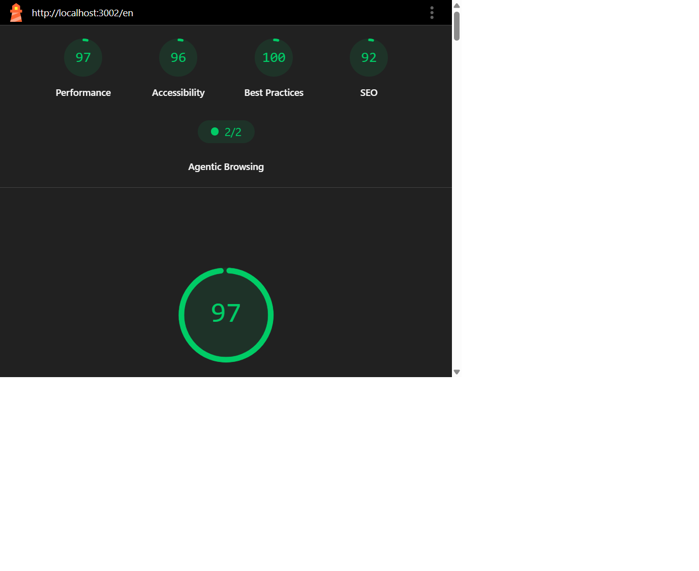

# Exclusive E-Commerce

## Live Demo

- [Open the live demo](https://exclusive-olive.vercel.app/)

- [English](https://exclusive-olive.vercel.app/en) | [Arabic](https://exclusive-olive.vercel.app/ar)

This project is a multi-language e-commerce mini website built with Next.js and TypeScript. It includes Arabic and English support, responsive design, product pages, cart, wishlist, checkout, account management, and local demo interactions.

The goal was to build a complete frontend experience close to the provided design, while keeping the code organized and maintainable.

## Project overview

This app is based on a modern Next.js App Router structure.

Main features:
- English and Arabic version in the same project
- RTL and LTR support
- product listing and category pages
- product details page
- shopping cart
- wishlist
- checkout flow with validation
- login and signup screens
- account page
- about and contact pages
- SEO and metadata setup
- local state persistence using Zustand

## Main pages

The project includes these main screens:
- Home
- About
- Contact
- Login
- Signup
- Account
- Cart
- Wishlist
- Category page
- Product details
- Checkout
- Not found page

## Stack used

- Next.js 15
- TypeScript
- React
- next-intl
- Zustand
- React Hook Form
- Zod
- FakeStoreAPI
- Tailwind CSS

## Project organization

The code was divided into clear folders so the project stays easy to read and maintain.

- src/app
  - main app routes
  - localized pages under src/app/[locale]
- src/components
  - reusable UI components
  - product-related sections
  - checkout, layout, home, shared UI sections
- src/hooks
  - custom logic hooks for product state and behavior
- src/store
  - cart store
  - wishlist store
  - auth store
- src/services
  - API calls to FakeStoreAPI
- src/lib
  - validation schemas
  - SEO helpers
- src/messages
  - Arabic and English translation content
- public/images
  - local images and design assets

## How I structured the code

I separated the project into page-level logic and reusable component-level UI.

For example:
- page file handles data and route-level setup
- client component handles the page interaction
- product sections were split into smaller parts like gallery, info, options, actions, delivery info, related products

This makes the code easier to understand and reduces the complexity of one big page.

The same idea was used for other large screens, especially checkout and account pages.

## Data flow

The app uses FakeStoreAPI for products and login demo data.

- Product data is requested from the service layer
- Pages load data and pass it to client components
- Zustand keeps cart, wishlist, and auth state in browser storage
- Forms validate user input with React Hook Form + Zod

## State management

I used Zustand for local data persistence.

Features handled by stores:
- cart items
- additions and removals from cart
- quantity updates
- wishlist items
- login/auth demo session
- coupon logic for checkout

This keeps the app lightweight without needing a backend.

## Localization

The app supports Arabic and English using next-intl.

Important points:
- route structure is locale-based
- translation messages are stored in src/messages
- layout and page directions are adjusted depending on locale
- Arabic pages use RTL direction

## Validation and forms

The checkout and account flows use validation rules.

Examples:
- required fields
- email validation
- phone validation
- password confirmation checks
- coupon validation for demo checkout

This makes the forms more stable and reduces invalid input.

## SEO and metadata

The project includes SEO setup such as:
- page metadata
- Open Graph tags
- Twitter metadata
- sitemap
- robots.txt
- JSON-LD for product and breadcrumb data

This was done to make the project closer to production-ready frontend work.

### SEO checklist

- [x] Localized page titles and descriptions using the Next.js Metadata API
- [x] Canonical URLs and English/Arabic language alternates for indexable localized routes
- [x] Open Graph and Twitter metadata
- [x] Product JSON-LD with an Offer, plus BreadcrumbList structured data
- [x] Localized sitemap entries for public pages, categories, and products
- [x] `robots.txt` with the sitemap URL
- [x] Lighthouse SEO score of 92 for the saved English/Arabic desktop and mobile reports

Cart, login, account, and wishlist pages are marked `noindex`; they are intentionally omitted from the public sitemap.

### Technology choices and tradeoffs

- Next.js App Router provides localized routes, route-level metadata, and server-rendered product details; client components handle interactive UI.
- `next-intl` handles English/Arabic routing and translations. FakeStoreAPI product content is English-only, so product text falls back to the API's English data while the surrounding interface is localized.
- Zustand persistence keeps cart, wishlist, and demo session state in the browser without requiring a backend.
- React Hook Form and Zod provide client-side form handling and validation.
- FakeStoreAPI supplies sample product and login data. Payments, account creation, and contact submissions are not backed by production services.

### Lighthouse evidence

The following scores are from the saved accessible audit reports generated on 2026-11-07. The older baseline reports include an English mobile Performance score of 87; the accessible audit runs below are the later saved runs. Re-run Lighthouse after any further changes before submission.

| Locale | Device | Performance | Accessibility | Best Practices | SEO | Evidence |
| --- | --- | ---: | ---: | ---: | ---: | --- |
| English | Desktop | 100 | 92 | 100 | 92 | [Screenshot](docs/lighthouse/en-desktop-accessible-lighthouse.png) · [HTML](docs/lighthouse/en-desktop-accessible.report.html) · [JSON](docs/lighthouse/en-desktop-accessible.report.json) |
| English | Mobile | 97 | 96 | 100 | 92 | [Screenshot](docs/lighthouse/en-mobile-accessible-lighthouse.png) · [HTML](docs/lighthouse/en-mobile-accessible.report.html) · [JSON](docs/lighthouse/en-mobile-accessible.report.json) |
| Arabic | Desktop | 100 | 96 | 100 | 92 | [Screenshot](docs/lighthouse/ar-desktop-accessible-lighthouse.png) · [HTML](docs/lighthouse/ar-desktop-accessible.report.html) · [JSON](docs/lighthouse/ar-desktop-accessible.report.json) |
| Arabic | Mobile | 94 | 100 | 100 | 92 | [Screenshot](docs/lighthouse/ar-mobile-accessible-lighthouse.png) · [HTML](docs/lighthouse/ar-mobile-accessible.report.html) · [JSON](docs/lighthouse/ar-mobile-accessible.report.json) |

<details>
<summary>English desktop Lighthouse screenshot</summary>


</details>

<details>
<summary>English mobile Lighthouse screenshot</summary>


</details>

<details>
<summary>Arabic desktop Lighthouse screenshot</summary>


</details>

<details>
<summary>Arabic mobile Lighthouse screenshot</summary>


</details>

## How to run the project

Requirements:
- Node.js 20 or higher
- npm

Install dependencies:

```bash
npm install
```

Run the app:

```bash
npm run dev
```

Open the website in the browser:

- English: http://localhost:3000/en
- Arabic: http://localhost:3000/ar

## Useful checks

```bash
npm run lint
npx tsc --noEmit
npm run build
```

## Notes

This is a frontend demo project, not a real e-commerce backend.

So:
- login is demo-only
- signup does not create a real user
- checkout does not process a real payment
- contact form does not send real email
- products come from a public sample API

This is normal for a frontend challenge and keeps the project focused on UI, UX, and architecture.

## Final note

This project was built with the goal of creating a complete e-commerce frontend experience, with a clean structure, responsive layout, bilingual support, and real UI logic.

The main focus was to make the interface look close to the provided design while keeping the code readable and organized.


